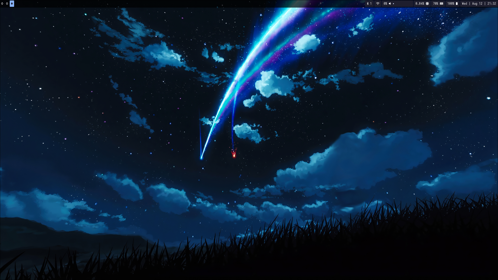
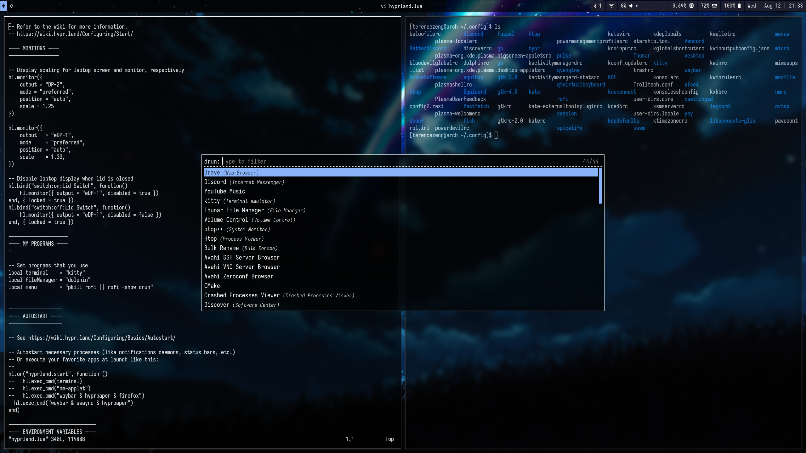

Currently, I'm using Arch (btw) as my distro with Niri as my window compositor. My main goal is to create a lightweight but polished environment that can run on low-resource machines (like my T480 with 8GB of RAM).

I previously used Hyprland as well, but I found that the workflow of Niri works particularly well with smaller laptop screens and switching between adjacent windows is seamless.

---

### Packages

I try to keep my list of installed packages to an absolute minimum. As of September 23, 2026, I have __ packages, not including dependencies. The main ones are:

* base, base-devel
  * essential tools
* bluez, bluez-utils, bluetui
  * nice UI for bluetooth connections, works with button on waybar
  * bluez can be omitted from installationsince it's a dependency
* brightnessctl
  * brightness control
* btop, htop
  * resource monitoring
* curl
  * client URL — useful command most commonly used for downloading files from a site
* efibootmgr
  * useful for dual booting, control which OS boots first
* git, github-cli
* gnome-keyring
  * passwords for gnome environments
* grub
  * grand unified bootloader
* intel-ucode
  * important processor patches for Intel CPUs
* keyd
  * remap keys at kernel level
* kitty
  * terminal of choice
* linux, linux-firmware
* networkmanager, nmrs
* niri
* ntfs-3g
  * important partitioning stuff for Windows/Linux dual boot
* os-prober
  * important to help GRUB scan for operating systems
* pavucontrol
  * pulseaudio volume control
* pipewire, pipewire-pulse, pipewire-audio, pipewire-alsa, wireplumber
  * audio stuff
* rofi
  * application launcher
* swaybg
  * wallpaper
* swaync
  * notification daemon
* thunar
  * lightweight file manager
* ttf-iosefka-nerd
  * nerd font
* unzip
  * tool to unzip zipped packages
* usbutils
  * tools to show info about usb devices like the “lsusb” command
* waybar
  * simple HTML status bar
* wl-clipboard
  * clipboard, copy paste functionality
* woff2-font-awesome
  * help display some icons like the ones in waybar
* xdg-desktop-portal, xdg-desktop-portal-gnome, xdg-desktop-portal-gtk
  * lets userspace perform kernel operations, for example screen sharing
* xdg-utils
  * includes xdg-open which lets you open links from non-browser windows
* xwayland-satellite
  * support for older apps that don’t work well with wayland (x11 is fallback)
* yay
  * package installer for arch

---

### Screenshots

